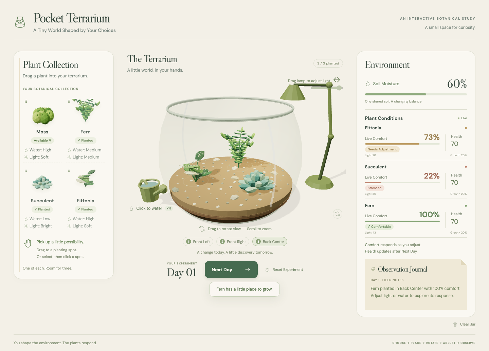

# Pocket Terrarium — Design and Development Process

SD5913 Assignment 3 — An interactive experience

## Starting idea

I often struggled to care for my own succulents, and some died. I wanted a simulator where I could experiment with looking after plants without risking more living plants. From that personal starting point, I developed the idea for others who love plants but struggle to keep them alive, as well as people interested in growing plants who lack the space or conditions to do so. I chose a miniature terrarium where people could arrange plants and discover how environmental choices affect them, without scores or tasks.

My central idea was that users should not directly command plants to grow. They should choose plants, adjust water and light, and observe the consequences. The loop became **plant → adjust → observe → advance time → try again**. One plant is enough to begin; the five-plant limit is capacity rather than a completion target.

I initially used a three-column 2D interface as the layout reference. I chose real 3D because changing a viewpoint and aiming water/light at a soil location should have spatial meaning. A static image would not let the user inspect or rearrange the world in this way. I kept ordinary HTML controls around the scene so that instructions and feedback would stay readable.

## Visual direction and interface

I wanted the terrarium to look like a small handmade world: bright low-poly plants, layered soil, simplified glass and restrained rocks/wood. Moss stays low, Fern is taller, Succulent forms a compact rosette, and Fittonia has broader veined leaves. These different silhouettes and heights make arrangement more interesting. Simplified transparency and broad glass highlights keep the plants visible without complex refraction.

For the surrounding interface, I chose cream paper, green and yellow accents, rounded Fredoka headings and DM Sans body text. I tried notebook covers/rings and a wooden tabletop with a cloth, but neither improved the result. The table and mat also exposed a perspective mismatch when some elements rotated and others did not. I returned to taped paper panels and a flat botanical background. This taught me that more decoration does not necessarily make an interaction clearer.

I also reduced the central heading so that it no longer competes with the product title, removed repeated slogans/instructions, and widened the status panel. The collection can slide away to leave more room for the scene, with a visible Plants tab to reopen it. I kept this reversible rather than hiding the collection permanently after planting.

*Application capture from the approved October 23 version. The background is decorative; the jar, plants and tools remain live 3D objects.*

## Interaction decisions and changes

My first version was an MVP for testing the basic loop: choose a plant, place it in one of three fixed positions, adjust the environment and advance a day to see its response. It helped me test whether the simulation and feedback worked before expanding the interaction.

*The first MVP: three fixed planting positions and a shared environment.*

In the current version, I changed planting to one to five freely positioned individuals, including repeated species, because choosing an arrangement should be part of the experiment. I also refined the controls and rendering to reduce interaction conflicts and improve responsiveness. Each individual keeps its own identity, Health and Growth when moved. Water belongs to the soil, so moving a plant changes the conditions at its roots rather than carrying its old water with it.

I separated left-button manipulation from right-button rotation to reduce conflicts. Invalid drops and cancelled gestures preserve the previous state. Visible rotation instructions, Reset view, click-to-place and keyboard alternatives give users ways to recover when dragging is difficult.

I changed watering from a whole-jar action into a local footprint large enough to reach neighboring roots. This creates a reason to think about which plants share an area. I also changed lighting from moving the lamp body to dragging the light spot, retaining only Range and Intensity controls. Hover feedback identifies the tools without a permanently floating animation or a large instruction box following the cursor.

To connect repeated plants with their data, I added a two-way link: hovering a plant highlights its status row; hovering or focusing the row outlines that individual. I kept Comfort as immediate environmental feedback, while Health/Growth update only after Next Day. A dated Last day record describes what already happened, not a prediction.

### One complete input–response–feedback loop

Local watering is the code path I would use to explain the project:

1. **Input:** the user drags the can to a soil location. Raycasting in [plantDrag.js](src/interactions/plantDrag.js) turns the pointer position into a world-space target.
2. **Response:** `onWater` in [main.js](src/main.js) passes that target to `waterSoil` in [simulation.js](src/simulation/simulation.js). Nearby soil samples gain moisture, with a tapered effect and a cap of 100; samples outside the footprint stay unchanged.
3. **Feedback:** the shared updated state refreshes soil color, local Comfort and short causes in the UI. The can tilts and droplets show where the action happened. Health does not jump immediately because it changes on Next Day.
4. **Next decision:** the user can see whether the affected plants need another adjustment, move a plant elsewhere, or advance time to observe its longer-term response.

This is more than a watering animation: the action changes stored environmental values that influence the next day's health and growth. The visual and numerical feedback come from those values rather than a preset outcome.

## User trials and my response

I gathered feedback in two rounds from three different people: one person in the first round and two more in the second. The first tester had followed my development and already knew how to play. After making changes based on that feedback, I invited two new users who had not seen the project to try it before I explained the controls; afterwards, I discussed their questions and suggestions with them. I kept their identities and private conversations private.

### First round: one user

Because the first tester already knew the project, their feedback could not fully represent a new user’s first experience. They gave brief feedback that interaction, especially rotation, felt slow and that changes in plant growth and health were much more noticeable in the numbers than in the models. I responded by reducing rendering work while preserving image clarity. I also made seedlings smaller, increased the difference between early and mature growth, added staged foliage and made growth transitions more noticeable. Poor health now also affects a plant's color and posture.

### Second round: two users

I then asked two new users to try the revised experience. Their feedback helped me identify problems with first-time guidance, controls and the meaning of the plant data.

| Feedback | My response |
| --- | --- |
| Soil average was confusing: it seemed like a value to match to plant needs, even in an empty jar. | I removed the ongoing whole-jar average and used an empty-state explanation and local condition messages instead. |
| Comfort and Health changes appeared contradictory, and a previous day's Health change could be mistaken for a prediction. Small diagnostic text made it hard to tell whether a plant needed water or light. | I distinguished Comfort now from the dated Last day result, made short condition messages more prominent, and removed repeated explanations and exact local readings. |
| The first planting action, draggable plant cards and the water and light controls were not easy to discover. The tester in the chat also found moving the lamp awkward from the front and preferred direct light targeting. | I clarified planting instructions, added cues for interactive cards and tools, and made the light spot the main target while keeping range and intensity controls. |
| Right-drag rotation was hard to discover, and the plant count did not clearly communicate capacity. | I made the rotation instruction and Reset view more visible and changed the count to say how many plants are planted out of a maximum of five. |
| A user suggested that plants should be able to die after prolonged poor care. | I added a death condition after persistently critical health, a dried plant model and a death label in the status panel. |

Afterwards, my own reviews led me to refine the plant-to-status highlighting and the scene framing.

## Technical choices, error handling and verification

I used Vite, vanilla JavaScript ES modules and Three.js, with no backend or paid service. With Codex's help, I separated the ecological rules from rendering and gave the UI and scene one shared application state. That makes it possible to test the rules independently and prevents camera movement or decorative brightness from changing plant conditions.

The rules are deliberately simplified. Comfort combines species-specific moisture/light suitability; Next Day dries the soil, recalculates comfort and updates Health/Growth. Very dry soil cracks, and persistently critical health eventually causes death. These rules support experimentation rather than real plant-care advice. Reset preserves planting positions and restarts the experiment; Clear removes the plants. Both ask for confirmation.

I selected ordinary mistakes that fit this interaction: dropping outside the jar, placing roots too close together, cancelling a drag, watering saturated soil and repeatedly clicking Next Day. Rejected placements leave the garden unchanged, Escape abandons unfinished gestures, water stays capped and the daily transition blocks duplicate advancement. An empty jar explains why Next Day is unavailable.

### Performance and rendering

In the first version, I had not paid enough attention to loading and rendering cost. The models had too many small geometric pieces, and rotating the scene repeatedly triggered rendering work, making interaction feel sluggish. I subsequently simplified the geometry and reduced unnecessary rendering. When an optimization made the scene blurry, I chose to preserve sharpness and reduce rendering work instead. The retained changes batch repeated leaves, simplify secondary geometry, cache shadows and stop drawing settled/hidden scenes. Debugging with Codex also found a camera-change callback that could start extra rendering loops; correcting that was more useful than continually reducing resolution. The canvas now keeps device resolution capped at DPR 2 during rotation and at rest.

Development diagnostics and screenshots helped me assess these changes. Camera fitting now leaves room for the jar, lamp, resting can and base, while the scene still returns to idle after interaction.

### What was checked

The recorded development checks include 40 Node rule/model tests, the core 22-check Chromium workflow, focused tool and plant/status-link checks, seven viewport sizes, and multiple camera angles. Coverage includes local water/light, daily updates, lifecycle boundaries, cancelled gestures, Reset/Clear, repeated species and resource cleanup. The Node tests and build passed for the October 23 functional release.

The production preview was checked under the GitHub Pages repository path so fonts, favicon and assets would load correctly. The public repository was also accessed without authentication during the submission review. The README provides reproduction commands; temporary browser output goes to ignored `test-results/`.

Remaining limits are no saved garden, simplified ecology, and incomplete physical-device/cross-browser testing. I would prioritize a short follow-up user trial and device checks over adding more features to this assignment.

## AI assistance and asset provenance

I used **OpenAI Codex** to generate and revise substantial parts of the JavaScript, procedural models, styling, tests and documentation. I used the **3dviz-pro-max** skill for guidance on the low-poly modeling and lighting direction, and OpenAI's image tool to explore background concepts and make the final decorative botanical image. My role was to define the intended experience, supply references, decide priorities, try the results, bring in user feedback and accept or reject changes.

### AI suggestions and results I kept

- **Procedural plants and thumbnails:** I kept the low-poly models and reused them for the collection thumbnails, making each plant recognizable in both the cards and the scene while allowing it to change as it grows.
- **Rendering efficiency:** I kept batched repeated leaves, simplified secondary geometry and cached shadows. These changes reduced rendering work while preserving the plants' silhouettes and lighting.
- **Growth feedback:** After the first tester found growth difficult to see, I asked Codex to make seedlings smaller and growth more visible. I kept the wider size range, staged leaves and growth transition because they make changes easier to observe.
- **Direct environmental controls:** I kept local watering and direct light-spot control developed with Codex. Watering an area makes plant placement meaningful, and moving the light spot is easier than manipulating the lamp from every angle.
- **Feedback and navigation:** I kept the short condition messages, the distinction between Comfort now and the previous day's Health change, and clearer rotation and reset controls. Linking a plant to its status row also helps users identify repeated species.
- **Botanical background:** I selected a botanical paper design from AI-generated variations and refined it with the image tool for the final interface.

### AI suggestions and results I rejected or changed

- **Lower rendering resolution:** One optimization improved responsiveness but made the scene visibly blurry. I rejected that tradeoff and asked Codex to reduce geometry and unnecessary rendering while retaining image clarity.
- **Notebook panels:** I tried notebook-style covers and binding in the AI-assisted interface revisions, but preferred the original paper-note panels and returned to them.
- **Tabletop and mat:** I tried a wooden tabletop and cloth, but the elements looked inconsistent when the scene rotated. I replaced that treatment with the botanical paper background.
- **Water and lamp controls:** I moved away from the first implementation's shared watering and movable lamp. I also changed an initial watering design focused on individual points into an area that can reach neighboring plants.
- **Crowded explanations:** I removed the soil average, exact local readings, repeated explanations and redundant instructions from successive interface revisions. Persistent tool labels also gave way to brief hover cues, leaving more room for the terrarium.
- **Fixed placement:** The first MVP had three fixed planting positions. I changed it to allow one to five freely placed plants, including repeated species, so arranging the garden became part of the experience.

The generated background, [botanical-journal.webp](src/assets/backgrounds/botanical-journal.webp), contains ivory grid paper and marginal foliage/flowers only. I asked the image tool to remove text, UI, models, tools, shadows, table and cloth from the concept before using it as a background. The interactive world is separate procedural Three.js geometry, not an image or prerecorded animation.

My supplied references informed layout, color and miniature composition rather than becoming bundled artwork. They included [Garden Galaxy](https://store.steampowered.com/app/1970460/Garden_Galaxy/) by Anneka Tran; an island/lighthouse image credited in the screenshot to “ubrilliantidiot”; illustrated interfaces, paper notes and a photographed terrarium. I could not find every original post or identify every creator, so those credits remain incomplete. [Carbon typography](https://www.carbondesignsystem.com/building-blocks/foundations/typography/overview) informed type hierarchy; [Filofax Botanical sticky notes](https://us.filofax.com/products/botanical-sticky-notes-filofax) and scrapbook references informed the subsequently rejected notebook exploration. Dependency and font credits remain in README, with bundled font licenses in the project.

The main lesson for me was that a convincing miniature is only useful when people understand what they can change and what the feedback means. Simplifying the lamp and data panel contributed more to that aim than adding more controls or decoration.
