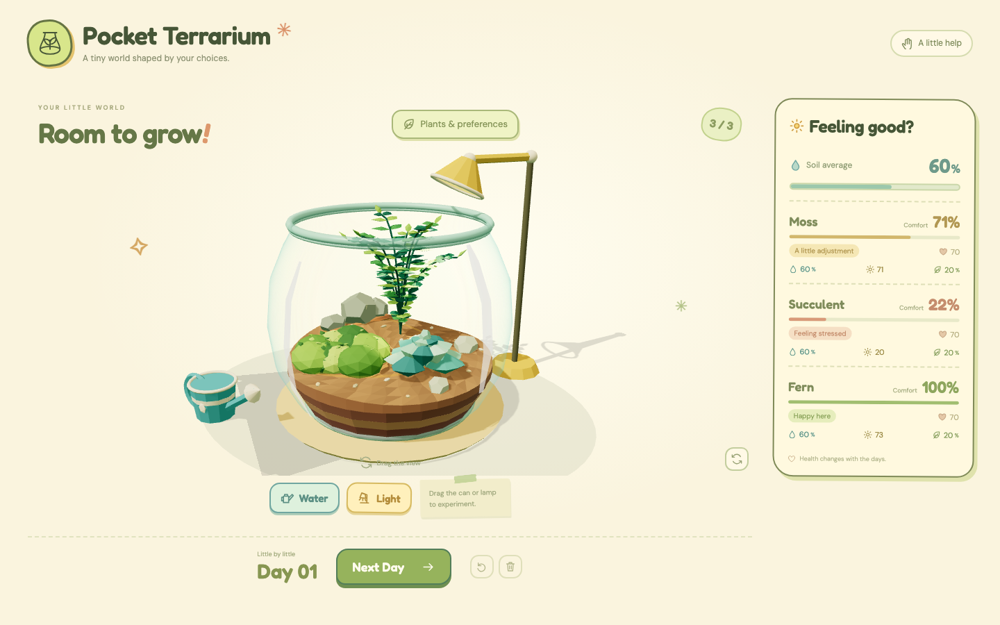

# Pocket Terrarium

A tiny interactive botanical world for a two-to-three-minute break. Choose plants, arrange their environment, and observe their responses. Built with Vite, vanilla JavaScript and Three.js; no backend, account, API or remote runtime assets.



## Run

Node.js 22.12+ recommended (20.19+ also supported).

```sh
npm install
npm run dev
npm test
npm run build
npm run preview
```

Open the URL printed by Vite. The current local workspace preview is at **http://127.0.0.1:5174/**. For browser checks, keep the development server running:

```sh
npx playwright install chromium
# Change the URL if your development server prints a different port.
TERRARIUM_TEST_URL=http://127.0.0.1:5174 npm run test:browser
```

On this Mac, `Start Terrarium.command` can use the Codex bundled Node runtime when Node is absent from the terminal PATH. Open the file from Finder to execute it; a file link in chat may instead open it in an editor.

## Controls

- Drag a collection card into a planting ring. The translucent model previews local comfort before release. A planted card selects/moves that existing plant rather than creating a duplicate.
- The collection collapses automatically after planting three species. Close it earlier with ×, or reopen **Plants & preferences** anytime. Confirmed Reset and Clear reopen the collection.
- Drag plants to move or swap them. Alternatively, select a card with click/Enter and choose a named spot. Escape/pointercancel cancels an unfinished operation.
- **Drag the watering can onto a soil patch and release.** The blue footprint has a fixed radius of 0.82 model units. Only samples within that patch gain water. The can lifts above the glass, pours at the chosen point, and returns. Alternatively, select Water and click any soil point. With the scene focused, arrow keys move a free target and Enter pours. A midpoint can water two neighbours at once; the footprint and soil field use the same radius.
- **Drag the lamp head** to orbit and extend it. Select **Light** to reveal Orbit, Reach, Beam and Power. Drag the light spot over the soil to aim, or choose a named spot. Zero power switches off the actual spotlight and footprint; ambient light remains.
- Drag empty scene space to orbit the camera; scroll to zoom. The circular arrow restores the view.
- Plant at least two species, then **Next Day**. Health and growth update only here; live comfort changes immediately with water, light and placement. The transition blocks repeated clicks for 800 ms.
- Reset keeps species/positions and restores the day, all water samples, lamp parameters, health and growth. Clear restores an empty initial experiment. Both require confirmation.

## Current spatial model

The jar is smaller than the initial MVP: soil radius 1.26, glass bulge radius 1.46, rim height 2.31. Sloped terrain, connected soil layers, stones and a small branch give the plants support and height variation. Fern is tallest, Fittonia medium, Succulent compact, and Moss a low spreading cushion. These are stylized representatives, not species-specific botanical measurements.

Water is stored on a deterministic hexagonal field. A shower adds up to 24 points at its centre, tapering to zero at radius 0.82; each sample caps at 100. Plant water values interpolate that field at their root positions. The soil-average bar is only a summary. Wetness stays in the soil when a plant moves.

Lamp geometry, spotlight, footprint and numeric light calculation share the same emitter, axis and cone angle. Reach moves both the head and light patch along the arm; direct aiming sets a new absolute target. Beam and power are independent. The simulation has ambient light 20 plus a bounded cone contribution, capped at 85; the readings are illustrative comfort units rather than measured lux. Daily drying is local: evaporation depends on light at each sample and uptake depends on nearby roots. Comfort remains 55% moisture suitability plus 45% light suitability. The initial health/growth values and daily health/growth rules remain unchanged.

## Code map

- `src/simulation/environment.js`: dimensions, terrain height, soil samples, water radius and lamp frame.
- `src/simulation/simulation.js`: immutable local water/light, comfort, day, reset and planting rules; no Three.js dependency.
- `src/scene/plantFactory.js`: four procedural models, thick custom leaf geometry, growth/health poses and shared-model thumbnails.
- `src/scene/terrarium.js`: faceted terrain, continuous soil sides, gravel and stylized Fresnel glass.
- `src/scene/lamp.js`, `wateringCan.js`, `footprint.js`: articulated tools, real spotlight, target footprints and water animation.
- `src/scene/createScene.js`: renderer/camera and animation; the render loop parks when idle.
- `src/interactions/plantDrag.js`: raycasting, plant/water/lamp gestures, cancellation and alternatives.
- `src/ui/`, `src/styles/main.css`: illustrated paper UI, controls, taped paper reminders and responsive layout.

## Verification and limitations

**18 simulation tests and 22 Chromium browser acceptance checks passed.** Production build succeeds. Browser checks include actual plant/water/head/aim dragging, isolated watering, narrow/zero/max beam controls, preserved health, camera invariance, reset, cancellation, idle rendering and a 390 px layout. The source-only and all-lights-off frames were inspected at fixed exposure. Actual screenshots are in `docs/screenshots/`; generated reports are in the ignored `test-results/` folder.

The latest refinement used the **3dviz-pro-max** object, material, lighting and inspection guidance with custom Three.js geometry/shaders; no catalog kit or external model was used. Supplied references were visual guidance only. Locally bundled fonts retain their OFL licenses.

Safari, Firefox, physical touch devices, older-Mac performance and real student usability sessions remain unverified. This simplified ecology omits moisture diffusion, leaf/root competition, physical fluids and calibrated plant-care science. There is no persistence: reload begins a fresh experiment.
