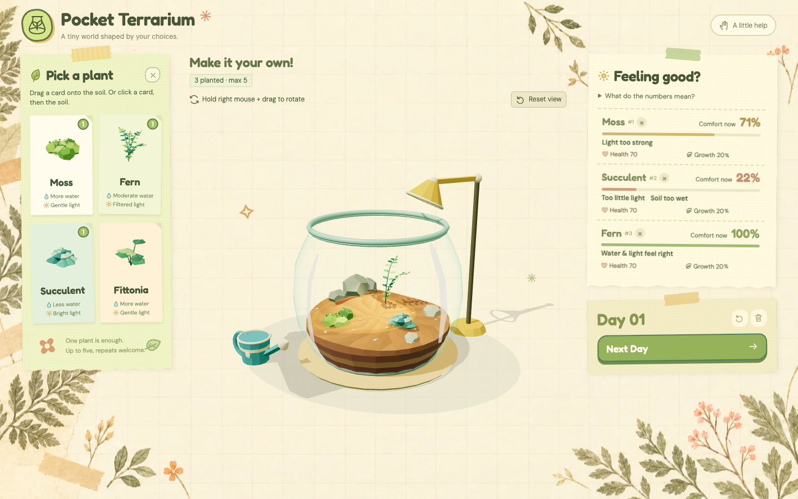

# Pocket Terrarium

SD5913 Assignment 3 — An interactive experience

**[Try the live experience](https://serena-3333.github.io/SD5913-assignment3-interactive-design/)**

A small terrarium simulator for people who love plants but struggle to keep them alive, or are curious about growing plants without having the space or conditions to do so. Choose plants, arrange their environment and discover how they respond. You influence growth through water, light and placement rather than directly controlling it. There are no scores, tasks or purchases.



## Try the main interaction

1. **Plant:** drag a plant card onto the soil, or click a card and then a soil spot. Choose one to five plants, including repeated species; one is enough to start.
2. **Adjust:** drag the watering can onto a patch, or drag the light spot to aim light. Click the fixed lamp to adjust Range and Intensity. Watering is local, so plant arrangement matters.
3. **Observe now:** Comfort and short causes such as “Too little light” respond immediately. Water darkens the soil; very dry soil develops cracks. Hover a plant or its status row to locate the matching individual.
4. **Advance time:** click Next Day. Soil dries, Health/Growth update, plants change size/color/posture, and a dated Last day record explains the completed health change. Poor conditions can eventually kill a plant, leaving a dry model.
5. **Experiment again:** move plants with the left mouse button. Hold the right button and drag to rotate; Reset view restores the camera. Reset experiment preserves planting positions and restarts conditions; Clear Jar removes all plants. Both ask for confirmation.

The Plants tab reopens the collection. For keyboard planting, select a card, focus the scene, use arrow keys and press Enter. The optional A little help menu explains alternative controls.

## Run locally

Requirements: Node.js 22.12+ (20.19+ also supported), npm, and a modern browser with WebGL. No account, backend, API key or paid service is required.

```sh
npm install
npm run dev
```

Open the local address printed by Vite in your browser. Serve the project this way rather than opening `index.html` directly.

To build and preview production:

```sh
npm run build
npm run preview
```

Open the preview address printed by Vite, including the repository subpath. The production base is `/SD5913-assignment3-interactive-design/`.

## Mistakes and interruptions

| Try this | Expected response |
| --- | --- |
| Drop a plant outside the soil, too near another root, or beyond capacity | Placement is rejected; no duplicate or partial plant is added. |
| Press Escape during an unfinished gesture | The gesture is cancelled and the previous garden state is kept. |
| Click Next Day with an empty jar, or repeatedly during its transition | The empty-state button is disabled with an explanation; the transition blocks repeated advancement. |
| Water an already saturated patch | Moisture stays capped and a short message explains that the patch is fully watered. |

## Verification and project files

`npm test` runs the rule/model tests. Optional browser checks require a running development server:

```sh
npx playwright install chromium
npm run test:browser
```

Set `TERRARIUM_TEST_URL` if Vite uses an address other than the browser checks' default. Additional layout, rendering and production checks are available in `package.json` and `tests/`.

- `src/simulation/`: independent ecological rules and individual plant state.
- `src/scene/`: procedural models, lighting and animation.
- `src/interactions/` and `src/ui/`: raycasting, gestures and feedback; `src/styles/` contains the interface styling.
- [PROCESS.md](PROCESS.md): my starting idea, design changes, two user-trial rounds with three people, AI choices and recorded validation.
- `screenshots/`: the final application capture. Temporary test output goes to ignored `test-results/`.

Dependencies are Three.js for 3D, Vite for serving/building and Playwright for browser checks. Versions and installation metadata are in `package.json` and `package-lock.json`. The [GitHub Actions workflow](.github/workflows/deploy.yml) tests, builds and deploys approved pushes to `main`.

## Known limitations

This is a stylized experiment, not real plant-care guidance. It omits moisture diffusion, mutual shading and root competition. There is no saved garden: reloading starts again. Desktop mouse interaction is the primary target; physical touch devices, older Macs and Safari/Firefox need further testing. Browser automation is not evidence of universal performance or successful user understanding. Recorded observations and validation limits are in [PROCESS.md](PROCESS.md).

## Credits

- **three.js** — 3D rendering, OrbitControls, Raycaster and geometry utilities; MIT. [Project](https://threejs.org/).
- **Vite** — development server and production bundling; MIT. [Project](https://vite.dev/).
- **Playwright** — browser interaction, rendering and deployment checks; Apache-2.0. [Project](https://playwright.dev/).
- **Fredoka** — Fredoka Project Authors; SIL Open Font License 1.1. [Bundled license](public/fonts/Fredoka-LICENSE.txt), [font source](https://github.com/hafontia/Fredoka-One).
- **DM Sans** — DM Sans Project Authors; SIL Open Font License 1.1. [Bundled license](public/fonts/DM-Sans-LICENSE.txt), [font source](https://github.com/googlefonts/dm-fonts).
- **Libre Caslon Display** — Libre Caslon Display Authors; SIL Open Font License 1.1. Bundled from the earlier visual direction. [Bundled license](public/fonts/Libre-Caslon-Display-LICENSE.txt), [font source](https://github.com/impallari/Libre-Caslon-Display).
